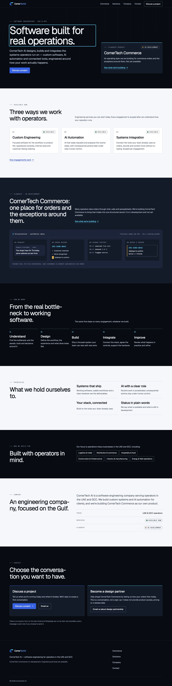
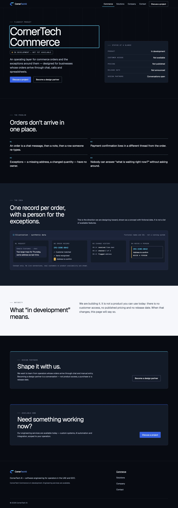
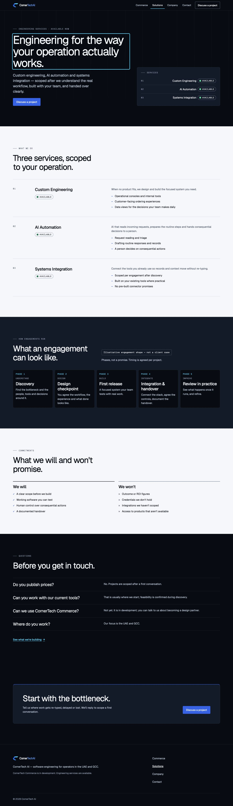
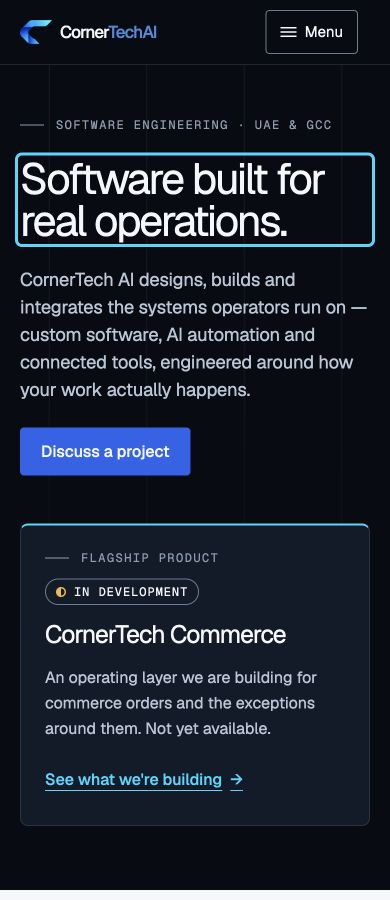

# Sprint02 React implementation evidence

Baseline production main: `4894c5b028cdb4ac469e5b7ecf01fd38c20330db`. Stacked development base PR98: `02fd40f7fae3c033efa81e02b021855c2a455d2c`. No merge, production deployment or infrastructure change.

Genuine Claude Code authored the four-file public experience contribution preserved in `2acf46b380c56a176779da68bf3d5b69f4c75a97`. The original output in CLAUDE_HANDOFF.md includes its independent review of the initial18-test isolation proposal; those findings drove the strengthened39-test guard. The report's not-run statements describe the contribution before Codex integration, not current verification.

Codex independently reviewed the contribution, corrected the Commerce destination, centralized route focus/scroll, added real three-route navigation/metadata and fixed the inherited1px overflow at319px with a public-only override. Existing CornerTechSite.tsx, backend/private code, security fixtures, dependencies and workflows remain unchanged. No PR99 source was shared in this collaboration.

Local verification:113frontend tests including39isolation cases, typecheck, production build and lint pass.19unchanged API containment/logging/inventory/protected-boundary tests pass using mocked/local HTTP; no production API actions. The built public bundle contains no Tres Leches/CornerMex, private API paths, evidence identifiers or unsupported enterprise claims. Exact-head repository CI is required on the Draft implementation PR.

Real browser evidence:24measurements, three pages at319/320/390/430/768/1024/1280/1440px, all document widths equal viewport widths; fonts/images loaded. Zero console warnings/errors. Mobile disclosure/Escape focus return, cross-route contact focus and project/design-partner destinations verified; exactly one WhatsApp action uses the approved destination, email separate. Native pointer navigation plus Back restored desktop offset4561.5px exactly and focused main; history.json records this. Playwright locator autoscroll moves sticky-navigation offsets before clicking, so that trace was not mistaken for application history evidence. Reduced-motion styling is retained; full200% text-resize/assistive-technology certification remains S04 QA, not claimed from screenshots.

**Draft / NO-GO for release.** Claude completed its contribution and initial isolation review, then its actual CLI returned a session limit resetting19:40Asia/Dubai. The final routing implementation, strengthened guard and integration corrections have NOT received independent Claude review. Do not substitute Codex self-review. Founder publication decisions remain gated: D1–D5 including company/design-partner copy, retained Gmail vs corporate email proposal, detailed per-capability evidence/approval and S03 initial-HTML metadata/real404/prerender review. No authenticated product access or product availability claim. Commerce remains IN DEVELOPMENT; no detailed capabilities table, customer case, form, tracker, private imports or live product integration.

Preview: http://127.0.0.1:4180/ ; /products/commerce ; /solutions. Client metadata and noindex are preview-only; legacy initial HTML/canonical is not production-ready route SEO. This preview is local, not a production deployment.

## Release preparation continuation —2026-10-23
Founder directed continued Codex execution without further Claude attempts. PR101 now targets main directly and contains the S01 documentation plus S02 implementation in one candidate; do not deploy PR98 separately. This does not claim independent Claude/CTO approval.

Public source now implements production-host-aware robots, per-route canonical/social metadata cleanup, hydration entry, build-only React prerender/document contracts, three-route crawler allowlist/sitemap, and an accessible404 component.118frontend tests, typecheck and current build pass.39transitive isolation tests remain intact.

The executable UNAPPLIED release prototype at http://127.0.0.1:4181/ additionally uses the pending protected serving/build exception: full initial HTML plus distinct metadata for all three routes, true404/noindex for missing/private paths and non-public-host noindex headers.15new local serving tests and17existing API containment/logging/inventory tests pass together (32total). Build-only generation uses existing Vite/React dependencies with no production SSR process or new sockets. The normal source build cannot emit those pages until the protected Vite configuration proposal is approved/applied.

release-prototype-browser.json records16measurements at actual CSS319/390/768/1440px including404, zero overflow; hydration/navigation console has no warnings/errors. release-prototype-navigation.json verifies canonical updates, heading focus, one WhatsApp action and separate email/design-partner paths. Prototype screenshots demonstrate the unapplied proposal; they are not evidence of a deployed or exact-head approved release.

Protected exception requested separately: src/app.js static-serving block only, frontend/vite.config.ts, new tests/publicStaticRelease.test.js and exact protected fixture. No protected file/assertion has yet changed. Pending approval is NOT inferred from the request to continue in Codex. Public parts can be reviewed now; final combined SHA/fullCI and release GO remain gated until that explicit exception is handled.

Rollback verified read-only in Railway: active SUCCESS a1491b7b-9525-4de9-96db-c7fd3502fd69 / main4894c5b028cdb4ac469e5b7ecf01fd38c20330db supports rollback/redeploy. If an approved release fails, restore this secure deployment with Founder-authorized rollback, verify strict HTTPS, public assets and GET health plus denied private API behavior; then revert the candidate through CI. No rollback, merge, deployment, production settings or credentials changed. Infrastructure PR99 stays separate/unmodified until its review/transfer gates are authorized; combining it into a future release requires a new exact union baseline and fullCI, not two automatic production merges.
